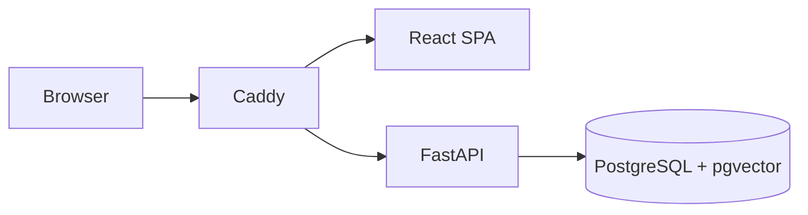

# KiboLens

KiboLens is a self-hosted, evidence-first infrastructure observability and investigation platform. It is designed for resource-conscious deployment on a private LAN and will report unavailable or stale infrastructure data rather than inventing status.

## Current scope

Phase 3 adds an optional low-resource Prometheus monitoring profile, authenticated host/container telemetry APIs, and unknown-aware Recharts dashboards. The investigation agent remains intentionally unavailable until a later phase; KiboLens never fabricates assistant findings.

## Quick start

1. Copy `.env.example` to `.env`, replacing `POSTGRES_PASSWORD`, `KIBOLENS_SESSION_HASH_SECRET`, and the placeholder database password in `KIBOLENS_DATABASE_URL`.
2. Install Docker Engine and Docker Compose on the intended host.
3. Run `docker compose -f deployment/docker-compose.yml up --build`.
4. In a second terminal, run `docker compose -f deployment/docker-compose.yml exec backend alembic upgrade head`.
5. Create the only administrator interactively: `docker compose -f deployment/docker-compose.yml exec backend python -m app.cli.bootstrap_admin`.
6. Open `http://localhost:8080`. The bind address is loopback-only by default.

The bootstrap command asks for a username and a password twice. It requires a minimum 14-character password and refuses to create an additional administrator.

`KIBOLENS_SESSION_COOKIE_SECURE=false` is suitable only for local HTTP development. Production configuration must use HTTPS, `KIBOLENS_ENVIRONMENT=production`, a non-empty `KIBOLENS_SESSION_HASH_SECRET`, and `KIBOLENS_SESSION_COOKIE_SECURE=true`.

For backend-only development, create a virtual environment in `backend`, install `requirements-dev.txt`, then run `uvicorn app.main:app --app-dir backend --reload`.

## Architecture

See `docs/ARCHITECTURE.md`, `docs/DEVELOPMENT.md`, and `DEVELOPMENT_STATUS.md` for phase details and deployment constraints.

Monitoring setup, retention, thresholds, exporter permissions, and alert routing are documented in `docs/MONITORING.md`.
