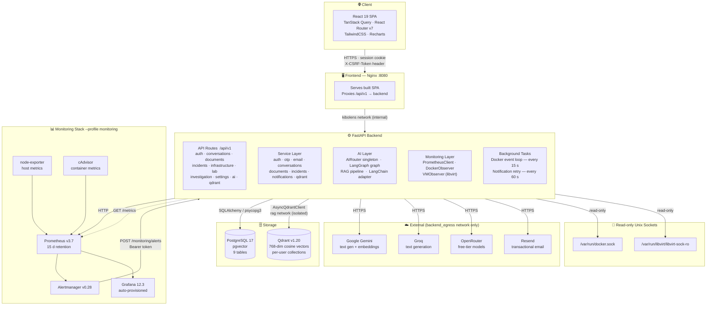
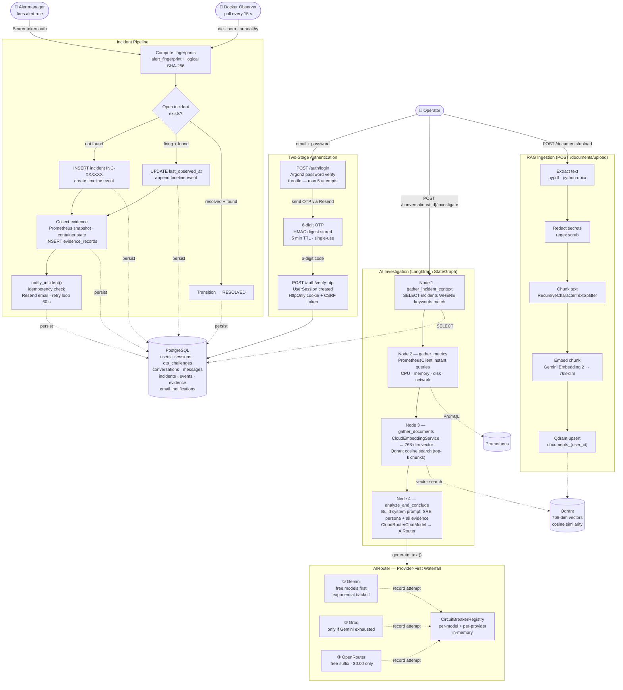

<div align="center">

# 🔭 KiboLens

**Self-hosted SRE operations platform — evidence-first incident management, AI-powered investigation, and infrastructure observability**

[](https://python.org)
[](https://fastapi.tiangolo.com)
[](https://react.dev)
[](https://typescriptlang.org)
[](https://postgresql.org)
[](https://qdrant.tech)
[](LICENSE)

<br/>

*Ask your infrastructure anything. Get evidence-backed answers — never fabricated data.*

</div>

---

## What is KiboLens?

KiboLens is a self-hosted platform that unifies infrastructure monitoring, incident lifecycle management, and AI-powered investigation into a single cohesive tool. It is built for the operator who wants to **understand what is happening**, not just see a dashboard go red.

- **Prometheus metrics** for CPU, memory, disk, temperature, containers, and VMs
- **Automatic incident detection** from Alertmanager webhooks and Docker lifecycle events
- **AI investigation chat** that pulls live Prometheus data, searches your knowledge base (RAG), and synthesises evidence-based findings — never invents data
- **Failure Lab** for controlled chaos engineering so you can test your runbooks before a real incident
- **Zero cloud dependencies at rest** — all data stays on your hardware; cloud AI providers are used only when you ask a question

---

## Table of Contents

- [Architecture Overview](#architecture-overview)
- [System Design](#system-design)
- [Quick Start](#quick-start)
- [Configuration Reference](#configuration-reference)
- [API Reference](#api-reference)
- [Failure Lab](#failure-lab)
- [Development](#development)

---

## Architecture Overview

KiboLens is a five-layer system: a React SPA served by Nginx, a FastAPI backend with four internal sublayers, relational storage (PostgreSQL), a vector database (Qdrant), and an optional monitoring stack. All external network access is funnelled through a single dedicated Docker network — the rest is internal-only.



---

## System Design

This diagram traces every major data flow end-to-end: how a user question becomes an AI investigation, how an Alertmanager alert becomes an incident with evidence and email notification, and how the AI routing engine selects a provider.



---

## Quick Start

### Prerequisites

- Docker Engine 24+ and Docker Compose v2
- A free [Resend](https://resend.com) account (email OTP — free tier is fine)
- At least one free API key from [Google AI Studio](https://aistudio.google.com), [Groq](https://console.groq.com), or [OpenRouter](https://openrouter.ai)

### 1. Clone and configure

```bash
git clone https://github.com/your-org/kibolens.git
cd kibolens
cp .env.example .env
```

Minimum required fields in `.env`:

```bash
# Database
POSTGRES_PASSWORD=your-secure-password

# Security  (generate with: openssl rand -hex 32)
KIBOLENS_SESSION_HASH_SECRET=your-64-char-hex-secret
KIBOLENS_OTP_HASH_SECRET=your-64-char-hex-otp-secret
KIBOLENS_ALERT_WEBHOOK_TOKEN=your-random-token

# Email
RESEND_API_KEY=re_xxxxxxxxxxxx
KIBOLENS_EMAIL_FROM=alerts@yourdomain.com

# AI providers (at least one)
GEMINI_API_KEY=AIza...
# GROQ_API_KEY=gsk_...
# OPENROUTER_API_KEY=sk-or-...

# Access control
KIBOLENS_ALLOWED_EMAILS=you@yourdomain.com
```

### 2. Start the stack

```bash
# Core services only
docker compose --env-file .env -f deployment/docker-compose.yml up --build -d

# With full monitoring stack (Prometheus · Alertmanager · Grafana)
docker compose --env-file .env -f deployment/docker-compose.yml --profile monitoring up --build -d
```

### 3. Run migrations

```bash
docker compose -f deployment/docker-compose.yml exec backend alembic upgrade head
```

### 4. Create your admin account

```bash
# First administrator
docker compose -f deployment/docker-compose.yml exec backend \
  python -m app.cli.bootstrap_admin

# Additional administrators
docker compose -f deployment/docker-compose.yml exec backend \
  python -m app.cli.provision_admin
```

Minimum password: **14 characters**.

### 5. Open the UI

Navigate to `http://localhost:8080`

Login: **email + password → OTP sent to your inbox → enter 6-digit code**

---

## Configuration Reference

All settings use the `KIBOLENS_` prefix unless noted. Loaded by `pydantic-settings` from `.env`.

| Variable | Default | Required | Description |
|---|---|---|---|
| `KIBOLENS_DATABASE_URL` | `postgresql+psycopg://...` | ✓ prod | PostgreSQL connection string (psycopg3) |
| `KIBOLENS_ENVIRONMENT` | `development` | | `development` or `production` |
| `KIBOLENS_SESSION_HASH_SECRET` | — | ✓ prod | HMAC-SHA256 secret for session tokens |
| `KIBOLENS_SESSION_COOKIE_SECURE` | `false` | ✓ prod | Set `true` behind HTTPS |
| `KIBOLENS_SESSION_TTL_HOURS` | `12` | | Session lifetime (1–168 h) |
| `KIBOLENS_OTP_HASH_SECRET` | `change-me` | ✓ prod | HMAC-SHA256 secret for OTP digests |
| `KIBOLENS_OTP_TTL_SECONDS` | `300` | | OTP expiry (60–600 s) |
| `KIBOLENS_ALERT_WEBHOOK_TOKEN` | — | ✓ prod | Bearer token for Alertmanager webhook |
| `KIBOLENS_ALLOWED_EMAILS` | `""` | ✓ | Comma-separated admin email allowlist |
| `RESEND_API_KEY` | — | ✓ prod | Resend transactional email key |
| `KIBOLENS_EMAIL_FROM` | `noreply@example.com` | | Sender address |
| `KIBOLENS_INCIDENT_NOTIFICATION_EMAILS` | `""` | | Comma-separated incident recipients |
| `GEMINI_API_KEY` | — | | Google Gemini API key |
| `GROQ_API_KEY` | — | | Groq API key |
| `OPENROUTER_API_KEY` | — | | OpenRouter API key |
| `KIBOLENS_LLM_PROVIDER` | `cloud` | | `cloud` or `ollama` (legacy) |
| `KIBOLENS_AI_FREE_ONLY` | `true` | | Reject non-free models |
| `KIBOLENS_AI_ALLOW_PAID_MODELS` | `false` | | Override — blocked in production |
| `KIBOLENS_AI_PROVIDER_TIMEOUT_SECONDS` | `45` | | Per-request timeout (max 60 s) |
| `KIBOLENS_AI_MODEL_CATALOG_REFRESH_HOURS` | `24` | | Model discovery refresh interval |
| `KIBOLENS_GEMINI_EMBEDDING_MODEL` | `gemini-embedding-2` | | Canonical embedding model |
| `KIBOLENS_GEMINI_EMBEDDING_DIMENSION` | `768` | | Vector dimension |
| `KIBOLENS_QDRANT_URL` | `http://localhost:6333` | | Qdrant endpoint |
| `KIBOLENS_PROMETHEUS_URL` | `http://localhost:9090` | | Prometheus endpoint |
| `KIBOLENS_CPU_WARNING_PERCENT` | `80` | | CPU warning threshold |
| `KIBOLENS_CPU_CRITICAL_PERCENT` | `90` | | CPU critical threshold |
| `KIBOLENS_MEMORY_WARNING_PERCENT` | `80` | | Memory warning threshold |
| `KIBOLENS_MEMORY_CRITICAL_PERCENT` | `90` | | Memory critical threshold |
| `KIBOLENS_DISK_WARNING_PERCENT` | `80` | | Disk warning threshold |
| `KIBOLENS_DISK_CRITICAL_PERCENT` | `90` | | Disk critical threshold |
| `KIBOLENS_DOCKER_OBSERVER_ENABLED` | `true` | | Poll Docker events for incidents |
| `KIBOLENS_DOCKER_SOCKET_PATH` | `/var/run/docker.sock` | | Docker socket path |
| `KIBOLENS_VM_OBSERVER_ENABLED` | `true` | | Enable libvirt VM inventory |
| `KIBOLENS_LIBVIRT_URI` | `qemu:///system` | | libvirt connection URI |

---

## API Reference

All endpoints are prefixed with `/api/v1`. Session cookie (`kibolens_session`) is required for all endpoints except health probes. Mutations require the `X-CSRF-Token` header.

### Authentication
| Method | Path | Description |
|--------|------|-------------|
| `POST` | `/auth/login` | Stage 1 — validate credentials, send OTP |
| `POST` | `/auth/verify-otp` | Stage 2 — verify OTP, create session |
| `POST` | `/auth/resend-otp` | Resend OTP (cooldown enforced) |
| `POST` | `/auth/logout` | Destroy session |
| `GET` | `/auth/me` | Current user info |
| `GET` | `/auth/csrf` | Refresh CSRF token |

### Infrastructure & Monitoring
| Method | Path | Description |
|--------|------|-------------|
| `GET` | `/infrastructure/summary` | Combined metrics snapshot |
| `GET` | `/infrastructure/metrics` | Current CPU · memory · disk · temperature |
| `GET` | `/infrastructure/metrics/history` | Range query history |
| `GET` | `/infrastructure/containers` | Docker container list + stats |
| `GET` | `/infrastructure/containers/{id}/details` | Container details + logs |
| `GET` | `/infrastructure/vms` | VM inventory via libvirt |
| `GET` | `/infrastructure/monitoring-status` | Prometheus reachability |
| `POST` | `/monitoring/alerts` | Alertmanager webhook receiver |

### Incidents
| Method | Path | Description |
|--------|------|-------------|
| `GET` | `/incidents/summary` | Open/total count stats |
| `GET` | `/incidents` | List (filter by status, severity) |
| `GET` | `/incidents/{id}` | Incident detail |
| `GET` | `/incidents/{id}/events` | Timeline events |
| `GET` | `/incidents/{id}/evidence` | Evidence records |
| `POST` | `/incidents/{id}/investigate` | Trigger AI investigation |
| `PATCH` | `/incidents/{id}/status` | Update status |
| `PATCH` | `/incidents/{id}/severity` | Update severity |
| `POST` | `/incidents/{id}/notes` | Add operator note |

### AI Chat & Investigation
| Method | Path | Description |
|--------|------|-------------|
| `POST` | `/conversations` | Create conversation |
| `GET` | `/conversations` | List conversations |
| `GET` | `/conversations/{id}/messages` | Get messages |
| `POST` | `/conversations/{id}/messages` | Add message |
| `POST` | `/conversations/{id}/investigate` | Run AI investigation |
| `DELETE` | `/conversations/{id}` | Delete conversation |
| `POST` | `/investigate` | Standalone investigation |

### Knowledge Base
| Method | Path | Description |
|--------|------|-------------|
| `POST` | `/documents/upload` | Upload document (multipart, max 10 MB) |
| `GET` | `/documents/list` | List documents |
| `POST` | `/documents/search` | Semantic search |
| `DELETE` | `/documents/{id}` | Delete document + vectors |

### Failure Lab
| Method | Path | Description |
|--------|------|-------------|
| `GET` | `/infrastructure/lab/scenarios` | Available scenarios |
| `GET` | `/infrastructure/lab` | Lab status |
| `POST` | `/infrastructure/lab/{scenario}/start` | Start scenario |
| `POST` | `/infrastructure/lab/{scenario}/stop` | Stop scenario |
| `POST` | `/infrastructure/lab/reset` | Reset all containers |

### Observability
| Method | Path | Description |
|--------|------|-------------|
| `GET` | `/health` | Liveness probe |
| `GET` | `/ready` | DB readiness probe |
| `GET` | `/metrics` | Prometheus scrape endpoint |
| `GET` | `/ai/health` | AI provider health + model counts |
| `POST` | `/ai/self-test` | Live generation test per provider (admin) |
| `GET` | `/qdrant/health` | Qdrant health |

---

## Failure Lab

The Failure Lab lets you trigger controlled infrastructure failures, watch KiboLens detect them as real incidents, and practice your investigation workflow — all without touching production.

Eight built-in scenarios:

| Scenario | Behaviour |
|----------|-----------|
| `crasher` | Crashes immediately on start |
| `cpu-stress` | Pegs CPU to trigger high-load alert |
| `memory-pressure` | Allocates until OOM killed |
| `restart-loop` | Crashes repeatedly, high restart count |
| `config-error` | Fails with config-related exit code |
| `unhealthy` | Docker `HEALTHCHECK` always fails |
| `missing-dependency` | Can't reach expected service |
| `interview-demo` | Controlled scenario for demos |

Each container is labelled `kibolens.lab=true`. The Docker observer picks up the lifecycle event (die / oom / unhealthy), creates a real incident through the normal pipeline, and sends notification emails — identical to a production alert. Use `POST /infrastructure/lab/reset` to bulk-clean all lab incidents.

---

## Development

### Backend

```bash
cd backend
python -m venv .venv && source .venv/bin/activate
pip install -r requirements-dev.txt

uvicorn app.main:app --app-dir backend --reload

pytest -v                                         # run tests
alembic upgrade head                              # run migrations
alembic revision --autogenerate -m "description" # new migration
```

### Frontend

```bash
cd frontend
npm install
npm run dev    # Vite dev server on :5173
npm run test   # vitest
npm run build  # production build
npm run lint   # ESLint
```

### Run datastores only, apps locally

```bash
docker compose -f deployment/docker-compose.yml up postgres qdrant -d

# backend on :8000, frontend on :5173 (Vite proxies /api to :8000)
cd backend && uvicorn app.main:app --app-dir . --reload
cd frontend && npm run dev
```

### Key source files

| File | Purpose |
|------|---------|
| `backend/app/main.py` | App factory, lifespan, background tasks |
| `backend/app/core/config.py` | All 60+ settings with validation rules |
| `backend/app/ai/router/core.py` | AIRouter singleton — the routing engine |
| `backend/app/ai/investigator.py` | LangGraph 4-node investigation graph |
| `backend/app/api/router.py` | Assembles all 13 route modules |
| `backend/app/services/incidents.py` | Full incident lifecycle |
| `backend/app/monitoring/docker_observer.py` | Docker event polling |
| `frontend/src/main.tsx` | React root — routing, auth context, query client |
| `frontend/src/services/http.ts` | Fetch wrapper with automatic CSRF injection |

---

## Docs

| Document | Contents |
|----------|---------|
| [`docs/ARCHITECTURE.md`](docs/ARCHITECTURE.md) | Detailed architecture notes |
| [`docs/DEPLOYMENT.md`](docs/DEPLOYMENT.md) | Production deployment checklist |
| [`docs/DEVELOPMENT.md`](docs/DEVELOPMENT.md) | Developer setup guide |
| [`docs/MONITORING.md`](docs/MONITORING.md) | Prometheus, Alertmanager, alert rules |
| [`docs/OTP_DEPLOYMENT_GUIDE.md`](docs/OTP_DEPLOYMENT_GUIDE.md) | OTP email auth setup |
| [`docs/SECURITY.md`](docs/SECURITY.md) | Security model and threat notes |

---

## License

[MIT](LICENSE)
