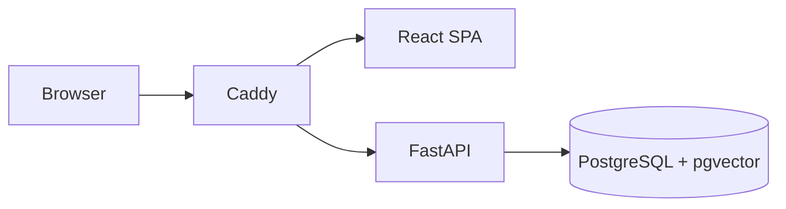

# KiboLens

KiboLens is a self-hosted, evidence-first infrastructure observability and investigation platform. It is designed for resource-conscious deployment on a private LAN and will report unavailable or stale infrastructure data rather than inventing status.

## Current scope

**Phase 5 - AI Chat (Complete):** Real-time infrastructure investigation using cloud-based AI models. Users can ask questions about their infrastructure through a conversational interface. The system gathers Prometheus metrics, retrieves relevant documentation from Qdrant, and uses a cloud AI router (Gemini → Groq → OpenRouter) with exhaustive free-tier fallback to generate evidence-based findings. All conversations are persisted with full message history. See `docs/AI_CHAT.md` for architecture, configuration, and troubleshooting.

**Phase 4.1 - OTP Authentication (Complete):** Production-ready two-administrator email authentication with mandatory OTP verification via Resend. Both approved administrator emails (rayanmohammedrafeeq@gmail.com, rakinmohammedrafeeq@gmail.com) are supported. Email + password authentication sends a 6-digit OTP; only successful OTP verification establishes an authenticated session. Includes multi-admin provisioning CLI, HMAC-based OTP storage, resend cooldown, attempt limits, and comprehensive test coverage (70 tests pass). See `docs/OTP_DEPLOYMENT_GUIDE.md` for configuration and deployment.

**Incident Management:** Alertmanager webhooks automatically create and update incidents with event timelines, evidence capture, lifecycle controls and linked AI investigations. Synthetic Failure Lab incidents are labeled separately and have administrator-only reset controls.

Knowledge Base and Settings are authenticated, functional application pages. See `docs/INTERVIEW_DEMO.md` for a reproducible demonstration.

## Quick start

### Traditional Username/Password (Legacy)

1. Copy `.env.example` to `.env`, replacing `POSTGRES_PASSWORD`, `KIBOLENS_SESSION_HASH_SECRET`, and the placeholder database password in `KIBOLENS_DATABASE_URL`.
2. Install Docker Engine and Docker Compose on the intended host.
3. Run `docker compose --env-file .env -f deployment/docker-compose.yml up --build`.
4. In a second terminal, run `docker compose --env-file .env -f deployment/docker-compose.yml exec backend alembic upgrade head`.
5. Create the only administrator interactively: `docker compose -f deployment/docker-compose.yml exec backend python -m app.cli.bootstrap_admin`.
6. Open `http://localhost:8080`. The bind address is loopback-only by default.

The bootstrap command asks for a username and a password twice. It requires a minimum 14-character password and refuses to create an additional administrator.

### Email OTP Authentication (Production)

For production deployment with email OTP authentication:

1. Configure Resend API key and email settings in `.env` (see `.env.example`)
2. Run database migration: `alembic upgrade head`
3. Provision administrators: `python -m app.cli.provision_admin` (run twice, once for each approved email)
4. Complete setup following `docs/OTP_DEPLOYMENT_GUIDE.md`

Email OTP authentication requires:
- Resend account with verified sending domain
- `RESEND_API_KEY` configured in `.env`
- `KIBOLENS_OTP_HASH_SECRET` (64-char hex)
- Both administrators provisioned with independent 14+ character passwords

Login flow: Email + Password → 6-digit OTP sent via email → OTP verification → Authenticated session

Without Resend API key, the system uses MockEmailService (OTP codes logged to backend logs for testing).

`KIBOLENS_SESSION_COOKIE_SECURE=false` is suitable only for local HTTP development. Production configuration must use HTTPS, `KIBOLENS_ENVIRONMENT=production`, a non-empty `KIBOLENS_SESSION_HASH_SECRET`, and `KIBOLENS_SESSION_COOKIE_SECURE=true`.

For backend-only development, create a virtual environment in `backend`, install `requirements-dev.txt`, then run `uvicorn app.main:app --app-dir backend --reload`.

## Architecture

See `docs/ARCHITECTURE.md`, `docs/DEVELOPMENT.md`, and `DEVELOPMENT_STATUS.md` for phase details and deployment constraints.

Monitoring setup, retention, thresholds, exporter permissions, and alert routing are documented in `docs/MONITORING.md`.
