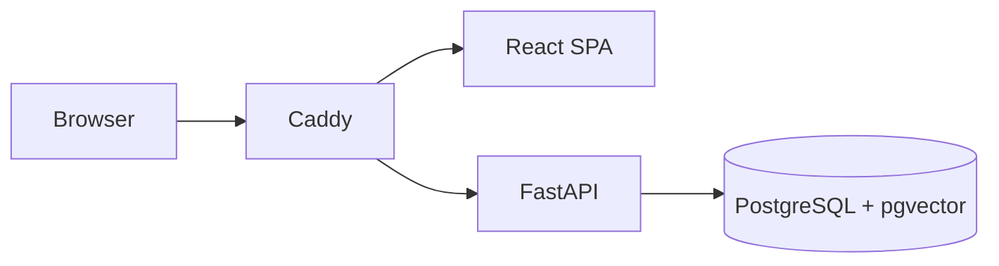

# KiboLens

KiboLens is a self-hosted, evidence-first infrastructure observability and investigation platform. It is designed for resource-conscious deployment on a private LAN and will report unavailable or stale infrastructure data rather than inventing status.

## Current scope

Phase 1 provides a React/Vite application shell, FastAPI health APIs, PostgreSQL/pgvector Compose configuration, SQLAlchemy 2 models, and Alembic migrations. Monitoring, authentication, incident management, RAG, and the investigation agent are intentionally scheduled for later phases.

## Quick start

1. Copy `.env.example` to `.env`, replacing `POSTGRES_PASSWORD` and the placeholder database password in `KIBOLENS_DATABASE_URL`.
2. Install Docker Engine and Docker Compose on the intended host.
3. Run `docker compose -f deployment/docker-compose.yml up --build`.
4. In a second terminal, run `docker compose -f deployment/docker-compose.yml exec backend alembic upgrade head`.
5. Open `http://localhost:8080`. The bind address is loopback-only by default.

For backend-only development, create a virtual environment in `backend`, install `requirements-dev.txt`, then run `uvicorn app.main:app --app-dir backend --reload`.

## Architecture

See `docs/ARCHITECTURE.md`, `docs/DEVELOPMENT.md`, and `DEVELOPMENT_STATUS.md` for phase details and deployment constraints.
